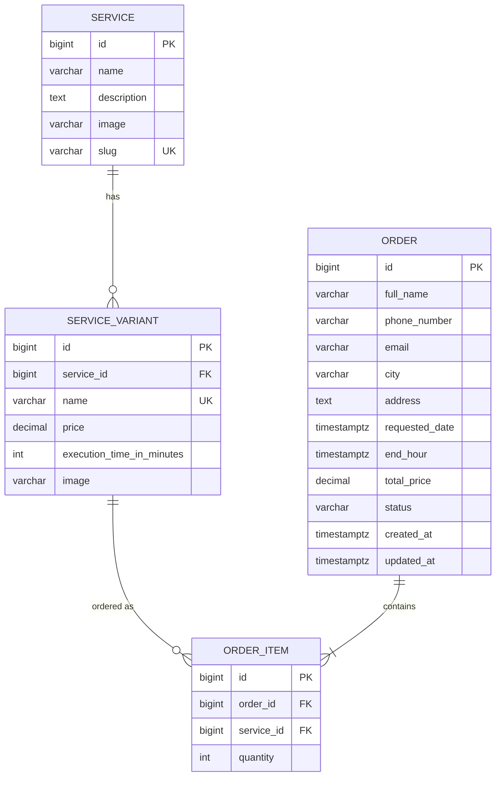

# LuxClean Documentation
 
A short technical reference for LuxClean. For installation steps, see the [README](README.md).
 
## Overview
 
Customers pick a service variant, fill in the order form with a live price calculator, choose a free time slot and receive a confirmation email. The owner manages orders and services from a custom admin panel. Customers do not need an account.
 
## Architecture
 
A standard Django project split into small apps, with class-based views and server-rendered templates. HTMX and some vanilla JavaScript handle the interactive parts.
 
| App | Purpose |
|-----|---------|
| `web` | Home, about and contacts pages |
| `services` | Services and their variants |
| `orders` | Order form, calendar and confirmation |
| `users` | Custom user model (`users.User`), used for admin accounts |
| `core` | Choices, validators, confirmation email, admin dashboard, management command |
 
Templates are in `templates/`, CSS and JavaScript in `static/`, uploaded images in `media/`.
 
## Database
 
PostgreSQL. The ERD below includes the tables Django creates for auth, sessions and the admin log.
 

 
The LuxClean tables:
 

 
- **Service:** the slug is generated from the Bulgarian name when empty. The image must be at least 1920x800 px.
- **ServiceVariant:** the priced option that customers actually order. It stores the price and how long the work takes.
- **Order:** statuses are `new`, `in_process`, `finished` and `denied`. `end_hour` is the start plus the total execution time.
- **OrderItem:** a variant and a quantity. The variant relation is `PROTECT`, so a variant that has been ordered cannot be deleted.
## Pages
 
| URL | Description |
|-----|-------------|
| `/` | Home page |
| `/about/`, `/contacts/` | Static pages |
| `/services/list/` | All services |
| `/services/<slug>/` | Service with its variants |
| `/orders/create/` | Calculator and order form |
| `/orders/calendar/` | Free and taken slots for a date (HTMX) |
| `/orders/confirmation/` | Shown once after a successful order |
| `/admin/` | Admin panel |
 
## Ordering rules
 
- Price and duration are always recalculated on the server from database prices.
- Orders of 200 EUR or more get a 5% discount.
- Bookings start between 09:00 and 17:30, on the hour or half hour, and must end by 18:30 the same day.
- The order and its items are saved in one transaction, and the confirmation email is sent after the commit.
## Admin panel
 
Built with django-unfold. Orders have status badges, filters, search, inline items and bulk status actions, and the sidebar shows how many orders are still new. The dashboard shows revenue, order counts, a 14-day trend, orders by status and the top services. Its data comes from `core/admin_dashboard.py`.
 
## Management command
 
```bash
python manage.py change_orders_status
```
 
Updates `new` and `in_process` orders by the current time (`in_process` once started, `finished` once ended). It is not scheduled by the project, so run it with cron or similar.
 
## Email
 
The confirmation email (plain text and HTML, in Bulgarian) is sent through django-anymail and the Brevo API. For local work, use Django's console email backend.
 
## Configuration
 
Settings come from environment variables in `.env`: `SECRET_KEY`, `DEBUG`, `POSTGRES_DB`, `POSTGRES_USER`, `POSTGRES_PASSWORD`, `DB_HOST`, `DB_PORT`, `EMAIL_BACKEND`, `BREVO_API_KEY` and `BREVO_API_URL`. The time zone is `Europe/Sofia`.
 
## Docker and CI
 
- `docker-compose.yml` runs the app and PostgreSQL 18. The container uses the Django development server, so it is meant for development and testing.
- GitHub Actions (`.github/workflows/ci.yml`) runs on pushes and pull requests to `main`. It builds the image, runs the migrations and runs the tests.
## Testing
 
```bash
python manage.py test
```
 
28 tests for the `orders` and `services` apps: forms, models and views, including price and discount calculation, booking validation and the confirmation email.
 
## Known limitations
 
- The overlap check only tests the start of a new order, not its full duration, and it counts denied orders as taken. There is also no locking, so two simultaneous requests for the same slot could both pass.
- The confirmation email is sent during the request. A provider outage after the order is saved would show an error page.
- Production still needs a proper WSGI server, `collectstatic`, media serving and environment-based settings (`ALLOWED_HOSTS`, `CSRF_TRUSTED_ORIGINS` and `DEFAULT_FROM_EMAIL` are hardcoded now).
- Only Sofia is available as a city, and orders are not linked to user accounts.
 