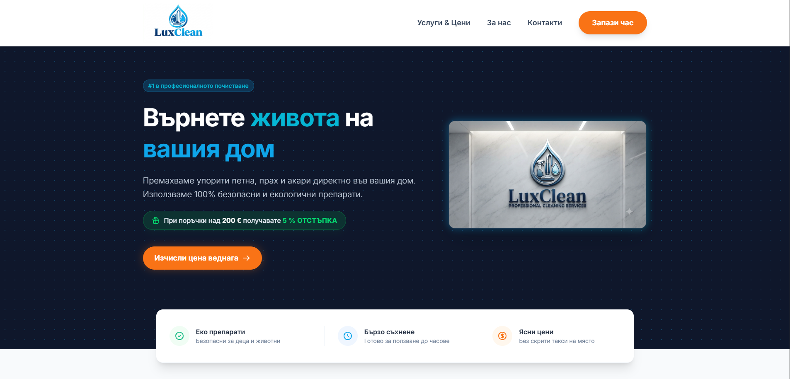
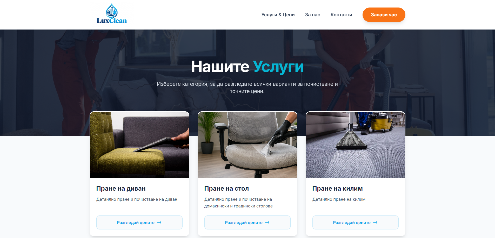
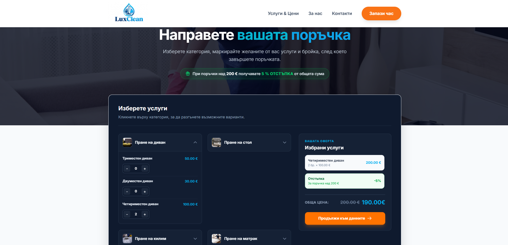
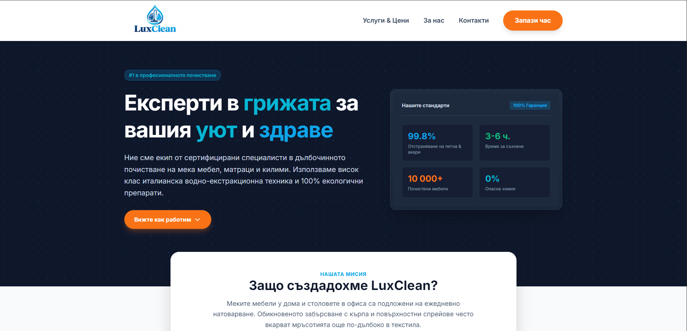
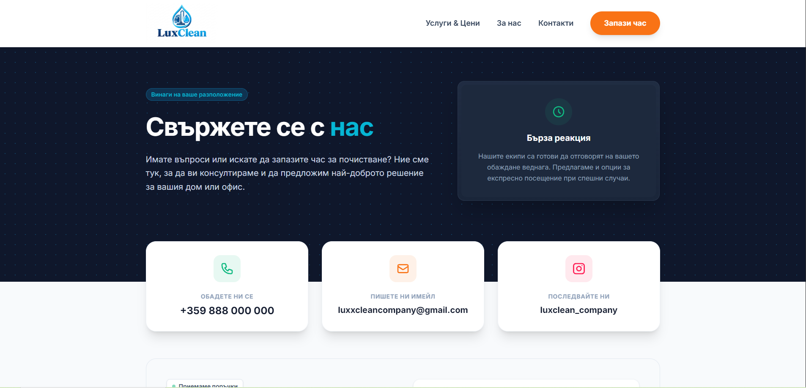
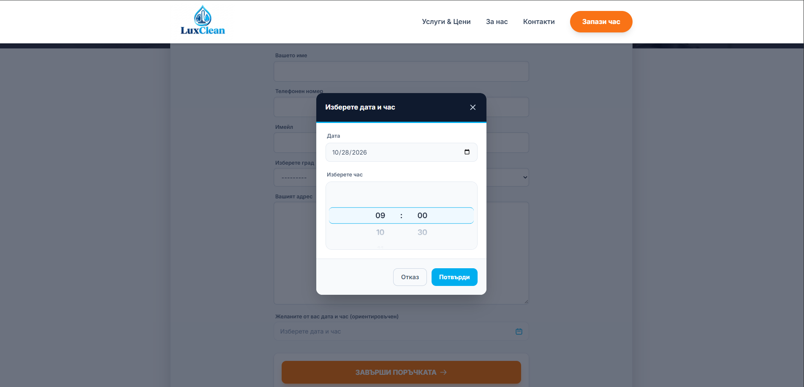
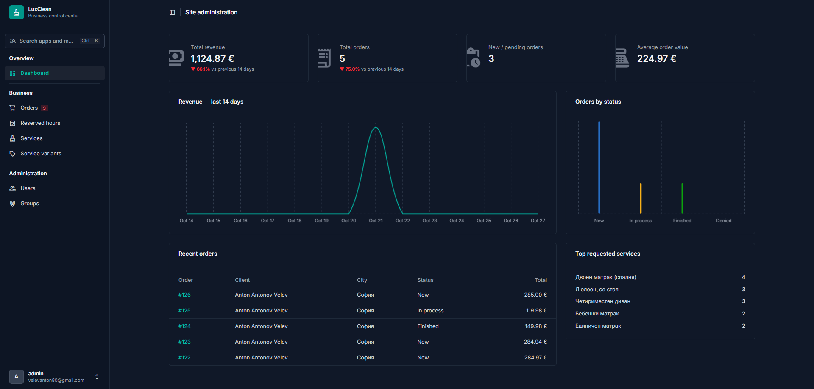
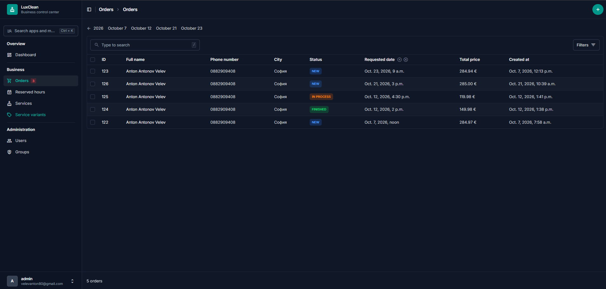

#  LuxClean

A web platform for a professional cleaning business, built with **Django**, **Tailwind CSS** and **PostgreSQL**.

> 🚧 **Work in progress:** this project is currently under active development. 🚧

##  Screenshots

| Home page | Services | Create order |
|:---------:|:--------:|:------------:|
|  |  |  |

<details>
<summary>📂 More screenshots</summary>

### 🌐 Public pages

| Service detail | About us | Contacts |
|:--------------:|:--------:|:--------:|
|  |  |  |

### 📝 Ordering

| Calendar |
|:--------:|
|  |

### 🛠️ Admin panel

| Dashboard | Orders |
|:---------:|:------:|
|  |  |

</details>

##  Project structure

| App | Purpose |
|-----|---------|
| `core` | Shared logic and base functionality |
| `web` | Public pages |
| `services` | Cleaning services offered |
| `orders` | Order creation logic |
| `users` | Accounts and authentication |


##  Technologies used

| Area | Technology |
|------|------------|
| **Language** | Python |
| **Backend** | Django |
| **Database** | PostgreSQL |
| **Frontend** | Tailwind CSS, Django Templates |
| **Tooling** | Node.js / npm (Tailwind build), Git |
| **Dev environment** | PyCharm, virtualenv (`.venv`) |


## 🚀 Getting started

```bash
# 1. Create and activate a virtual environment
python -m venv .venv
.venv\Scripts\activate

# 2. Install dependencies
pip install -r requirements.txt
npm install

# 3. Configure environment variables
copy .env.example .env

# 4. Apply migrations and run
python manage.py migrate
python manage.py runserver
```

## 👤 Author

**Anton Velev:** [LinkedIn](https://www.linkedin.com/in/anton-velev-python/)
