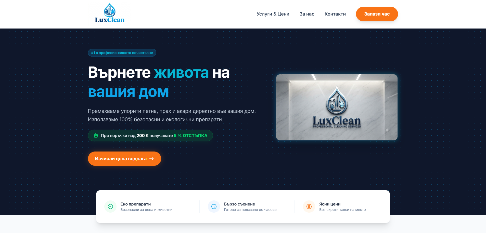
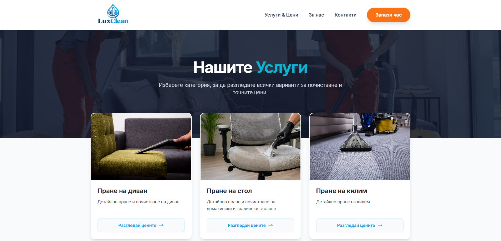
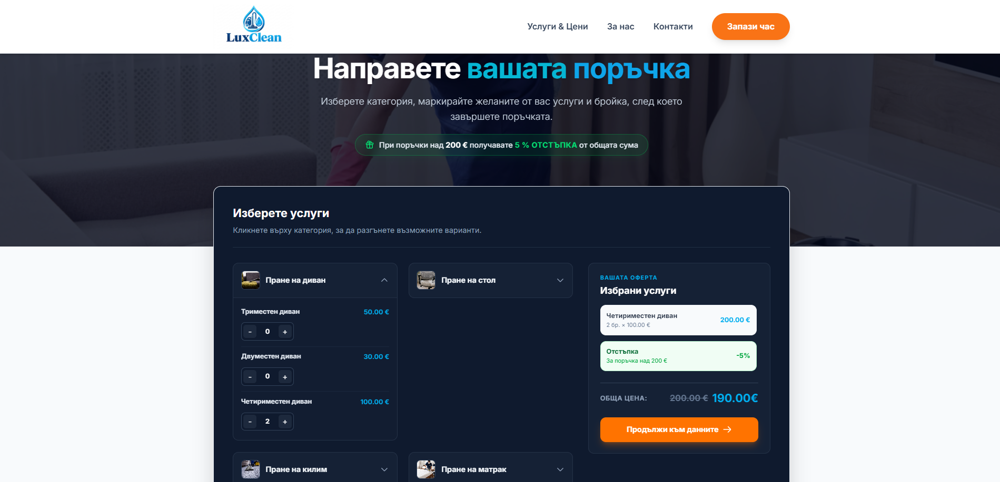
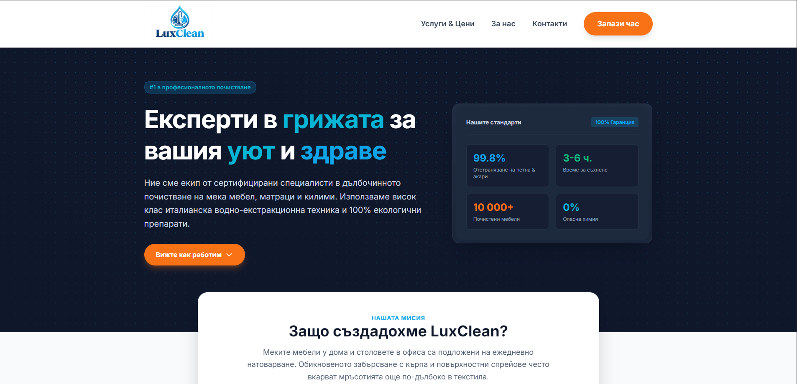
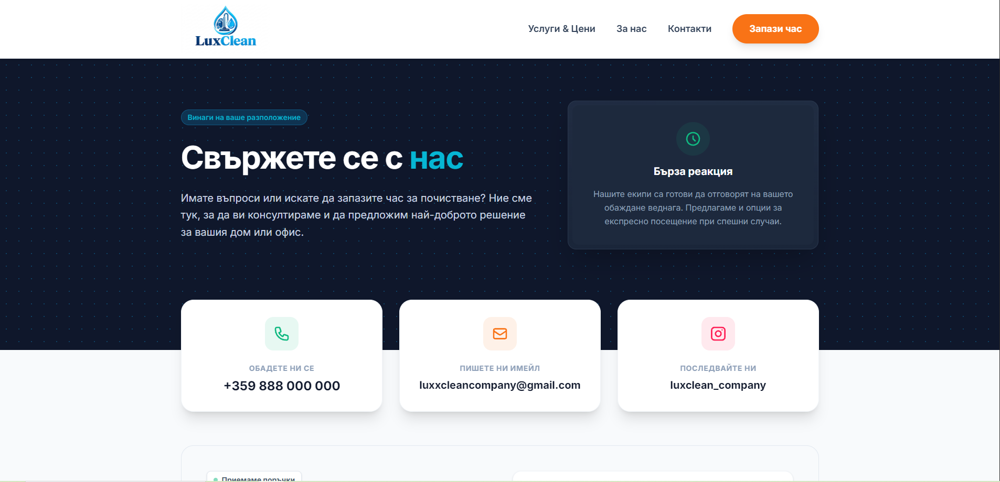
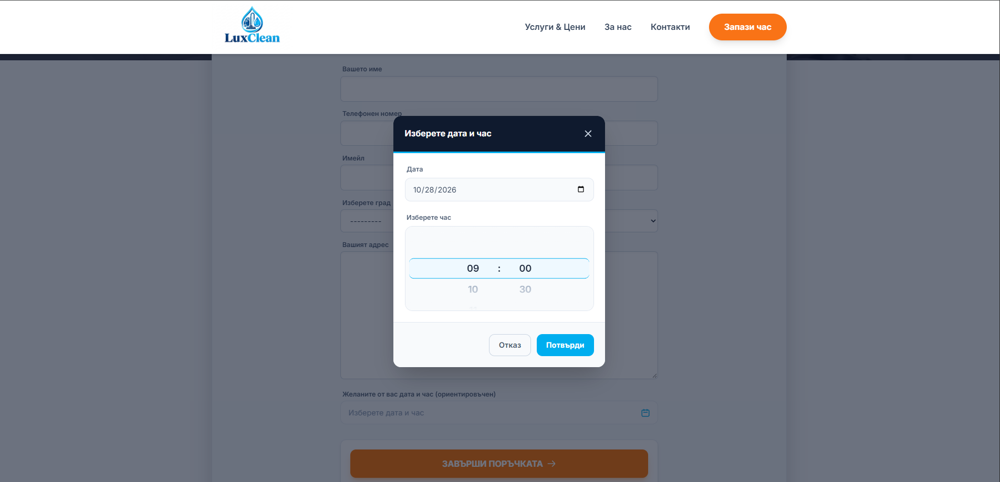
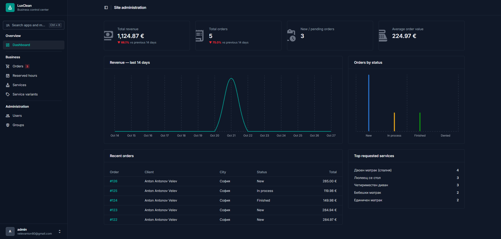
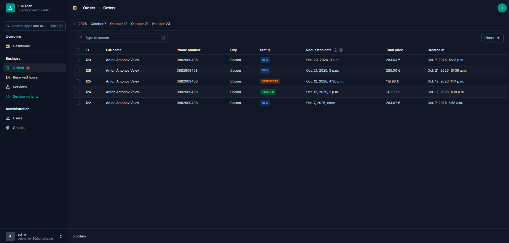

# LuxClean
 
A web platform designed to serve a real cleaning business, built with **Django**, **Tailwind CSS** and **PostgreSQL**.
 
**Live site:** [https://YOUR-DOMAIN](https://YOUR-DOMAIN)
 
Customers browse the services, build an order with a live price calculator, pick a free time slot and get a confirmation email. The owner manages everything from a custom admin panel with a small business dashboard.
 
> **Status:** the project is deployed on AWS EC2 and runs in Docker behind Nginx and Gunicorn. It is a complete, working application that is still being improved. See [DOCUMENTATION.md](DOCUMENTATION.md) for how it works, how it is deployed and the known limitations.
 
The interface is in Bulgarian, the code and the admin panel are in English.
 
## Screenshots
 
| Home page | Services | Create order |
|:---------:|:--------:|:------------:|
|  |  |  |
 
<details>
<summary>More screenshots</summary>
### Public pages
 
| Service detail | About us | Contacts |
|:--------------:|:--------:|:--------:|
|  |  |  |
 
### Ordering
 
| Calendar |
|:--------:|
|  |
 
### Admin panel
 
| Dashboard | Orders |
|:---------:|:------:|
|  |  |
 
</details>

## Features
 
- Service catalog with variants, prices and execution times
- Price calculator that updates the total as quantities change
- Time-slot booking in 30-minute steps, with free and taken hours loaded for the chosen day
- Automatic 5% discount on orders of 200 EUR or more
- Order confirmation page and an HTML confirmation email
- Custom admin panel (django-unfold) with a dashboard: revenue, order counts, a 14-day trend, orders by status and top services
- A management command that moves orders from new, to in process, to finished based on their time
## Project structure
 
| App | Purpose |
|-----|---------|
| `core` | Shared logic: choices, validators, confirmation email, admin dashboard, management command |
| `web` | Public pages: home, about, contacts |
| `services` | Cleaning services offered and their variants |
| `orders` | Order creation, calendar and confirmation |
| `users` | Custom user model, used for admin accounts |
 
## Technologies used
 
| Area | Technology |
|------|------------|
| **Language** | Python 3.12 |
| **Backend** | Django 5.2 |
| **Database** | PostgreSQL |
| **Frontend** | Tailwind CSS 4, Django Templates, HTMX, vanilla JavaScript |
| **Admin** | django-unfold |
| **Email** | django-anymail (Brevo API) |
| **Deployment** | AWS EC2, Docker, Nginx (reverse proxy), Gunicorn (WSGI server) |
| **Tooling** | Docker Compose, GitHub Actions, Node.js / npm (Tailwind build), Git |
| **Dev environment** | PyCharm, virtualenv (`.venv`) |
 
## Getting started
 
### Local setup
 
You need Python 3.12, Node.js and a running PostgreSQL database.
 
```bash
# 1. Create and activate a virtual environment
python -m venv .venv
.venv\Scripts\activate          # Linux / macOS: source .venv/bin/activate
 
# 2. Install dependencies
pip install -r requirements.txt
npm install
 
# 3. Configure environment variables
copy .env.example .env          # Linux / macOS: cp .env.example .env
 
# 4. Apply migrations, create an admin user and run
python manage.py migrate
python manage.py createsuperuser
python manage.py runserver
```
 
The site runs at http://127.0.0.1:8000 and the admin at http://127.0.0.1:8000/admin/.
 
### With Docker
 
```bash
cp .env.example .env            # set DB_HOST=postgres for this setup
docker compose up --build
 
# in a second terminal
docker compose exec backend python manage.py migrate
docker compose exec backend python manage.py createsuperuser
```
 
### Environment variables
 
Settings are read from the `.env` file in the project root.
 
| Variable | Purpose |
|----------|---------|
| `SECRET_KEY` | Django secret key |
| `DEBUG` | `True` for development, anything else counts as off |
| `POSTGRES_DB`, `POSTGRES_USER`, `POSTGRES_PASSWORD` | Database credentials, also used by the Postgres container |
| `DB_HOST`, `DB_PORT` | `127.0.0.1` and `5432` locally, `postgres` as host with Docker Compose |
| `EMAIL_BACKEND` | For example `anymail.backends.brevo.EmailBackend`, or Django's console backend for local work |
| `BREVO_API_KEY`, `BREVO_API_URL` | Credentials for sending confirmation emails through Brevo |
 
### Tailwind CSS
 
The compiled stylesheet (`static/css/output.css`) is committed. After changing templates or `static/css/tailwind.css`, rebuild it:
 
```bash
npm run build:css     # one-off, minified
npm run watch:css     # rebuild on change while developing
```
 
## Deployment
 
The live site runs on an AWS EC2 instance. Everything runs in Docker: Gunicorn serves the Django app and Nginx sits in front of it as a reverse proxy. See [DOCUMENTATION.md](DOCUMENTATION.md#deployment) for the details.
 
## Running the tests
 
```bash
python manage.py test
```
 
There are 28 tests covering the models, forms and views of the `orders` and `services` apps: price and discount calculation, booking validation, slug generation and the confirmation email. The suite also runs on every push and pull request to `main` through GitHub Actions.
 
## Documentation
 
How the database, the ordering rules, the admin and the deployment work is described in [DOCUMENTATION.md](DOCUMENTATION.md).
 
## Author
 
**Anton Velev:** [LinkedIn](https://www.linkedin.com/in/anton-velev-python/) - [GitHub](https://github.com/AntonVelev21)